# JARKOM MODUL 3 2026 - K61

## Member

| Nama               | NRP        |
| ------------------ | ---------- |
| Ferlin Erdina Sari | 5027251002 |
| Achmad Rifqy Aqila | 5027251102 |

## Laporan

1. Ketika Curtain menutup Shibuya, jalur komunikasi antar zona Jujutsu High terputus. Pulihkan konektivitas dasar dengan mengonfigurasi jichi: eth0 memperoleh WAN dari NAT, sedangkan eth1–eth4 menjadi gateway Network 1–4 sesuai tabel pemetaan. Aktifkan IPv4 forwarding dan source NAT, lalu tetapkan IP statis host infrastruktur sesuai tabel spesifikasi. Buktikan konektivitas setiap host ke gateway dan akses eksternal dari host yang relevan.

Untuk memulihkan konektivitas dasar di seluruh zona Jujutsu High, dilakukan pengaturan IP address, gateway, dan routing pada router utama **`jichi`** serta penetapan IP statis pada node infrastruktur utama.

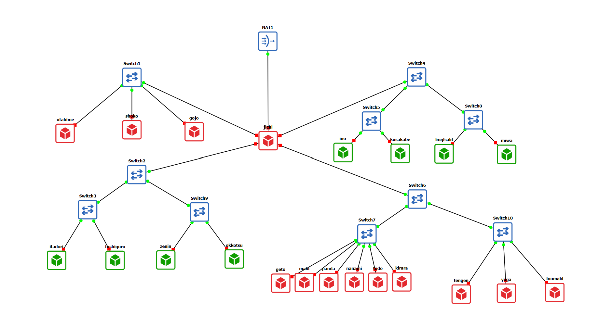

### Langkah Penyelesaian:

1. **Konfigurasi Interface Router `jichi`**:
   Interface `eth0` dikonfigurasi untuk memperoleh alamat IP dinamis dari NAT WAN (Internet), sedangkan interface `eth1` hingga `eth4` dikonfigurasi sebagai gateway internal untuk masing-masing subnet:
   - **Network 1 / DMZ (`eth1`)**: IP `10.94.1.1/24`
   - **Network 2 / Divisi A (`eth2`)**: IP `10.94.2.1/24`
   - **Network 3 / Divisi B (`eth3`)**: IP `10.94.3.1/24`
   - **Network 4 / Data Center (`eth4`)**: IP `10.94.4.1/24`

2. **Pengaktifan IPv4 Forwarding & Source NAT (MASQUERADE)**:
   Mengaktifkan fitur _packet forwarding_ pada kernel router `jichi` dan menerapkan aturan `iptables` dengan target `MASQUERADE` pada interface `eth0` agar seluruh trafik dari jaringan internal dapat mengakses internet luar.

3. **Penetapan IP Statis Host Infrastruktur**:
   Menetapkan IP statis dan gateway default secara manual pada berkas `/etc/network/interfaces` atau skrip persisten untuk node-node infrastruktur utama:
   - **`utahime` (DNS Master)**: IP `10.94.1.2/24`, Gateway `10.94.1.1`
   - **`shoko` (DNS Slave)**: IP `10.94.1.3/24`, Gateway `10.94.1.1`
   - **`gojo` (DMZ Gateway)**: IP `10.94.1.10/24`, Gateway `10.94.1.1`
   - **`tengen` (DHCP Server)**: IP `10.94.4.10/24`, Gateway `10.94.4.1`

#### Skrip Otomatisasi Router `jichi` (`soal1_3.sh`):

```bash
#!/bin/bash

# 1. Konfigurasi IP eth0 (WAN/NAT) & Interface Internal
ifconfig eth0 192.168.122.100 netmask 255.255.255.0 up
ip route add default via 192.168.122.1 dev eth0 2>/dev/null

ifconfig eth1 10.94.1.1 netmask 255.255.255.0 up
ifconfig eth2 10.94.2.1 netmask 255.255.255.0 up
ifconfig eth3 10.94.3.1 netmask 255.255.255.0 up
ifconfig eth4 10.94.4.1 netmask 255.255.255.0 up

# 2. Set DNS Resolver
echo "nameserver 192.168.122.1" > /etc/resolv.conf
echo "nameserver 8.8.8.8" >> /etc/resolv.conf

# 3. Simpan Konfigurasi Interfaces
cat <<EON > /etc/network/interfaces
auto lo
iface lo inet loopback

auto eth0
iface eth0 inet static
    address 192.168.122.100
    netmask 255.255.255.0
    gateway 192.168.122.1

auto eth1
iface eth1 inet static
    address 10.94.1.1
    netmask 255.255.255.0

auto eth2
iface eth2 inet static
    address 10.94.2.1
    netmask 255.255.255.0

auto eth3
iface eth3 inet static
    address 10.94.3.1
    netmask 255.255.255.0

auto eth4
iface eth4 inet static
    address 10.94.4.1
    netmask 255.255.255.0
EON

# 4. Routing & NAT MASQUERADE
sysctl -w net.ipv4.ip_forward=1
iptables -t nat -A POSTROUTING -o eth0 -j MASQUERADE

# 5. Bypass Signature Validation pada Update & Install DHCP Relay
apt-get update -o Acquire::Check-Valid-Until=false --allow-unauthenticated
apt-get install -y --allow-unauthenticated isc-dhcp-relay

# 6. Konfigurasi FileS /etc/default/isc-dhcp-relay
cat <<EON > /etc/default/isc-dhcp-relay
SERVERS="10.94.4.10"
INTERFACES="eth2 eth3 eth4"
OPTIONS=""
EON

# Restart Service Relay
/etc/init.d/isc-dhcp-relay restart 2>/dev/null || service isc-dhcp-relay restart

```


#### Pengujian

```bash
# Ping dari utahime ke Gateway
ping -c 2 10.94.1.1

# Ping dari utahime ke Internet
ping -c 2 8.8.8.8
```

---

2. Tengen, penjaga pusat distribusi di Data Center, harus mengambil alih pengalokasian alamat bagi wilayah yang membutuhkan konfigurasi dinamis. Konfigurasikan isc-dhcp-server pada 10.94.4.10. Deklarasikan Network 4 (10.94.4.0/24) sebagai subnet lokal tanpa pool dinamis, lalu siapkan scope DHCP untuk Network 2 (10.94.2.0/24) dan Network 3 (10.94.3.0/24). Validasi konfigurasi dan pastikan service aktif tanpa error “No subnet declaration”.

Untuk mengonfigurasi **`tengen`** (`10.94.4.10`) sebagai pusat server DHCP terpusat, dilakukan pemasangan paket `isc-dhcp-server` dan deklarasi subnet jaringan internal pada berkas konfigurasi `/etc/dhcp/dhcpd.conf`.

### Langkah Penyelesaian:

1. **Deklarasi Subnet Lokal Network 4 (`10.94.4.0/24`)**:
   Agar daemon DHCP tidak menghasilkan kesalahan (_error_) _"No subnet declaration for eth0"_, subnet lokal tempat server `tengen` berada (`10.94.4.0/24`) wajib dideklarasikan di dalam berkas konfigurasi tanpa menyertakan `range` IP dinamis.

2. **Deklarasi Scope DHCP Network 2 (`10.94.2.0/24`) dan Network 3 (`10.94.3.0/24`)**:
   Menyiapkan blok konfigurasi subnet untuk jaringan lokal yang nantinya akan dilayani melalui mekanisme DHCP Relay (`jichi`).

3. **Penetapan Interface Server**:
   Mengarahkan listening interface DHCP pada berkas `/etc/default/isc-dhcp-server` ke `eth0`.

#### Konfigurasi Berkas `/etc/dhcp/dhcpd.conf` pada Node `tengen`:

```dhcpd
# Global Options
default-lease-time 600;
max-lease-time 7200;
authoritative;

# 1. Subnet Lokal Server Tengen (Tanpa Pool Dinamis)
subnet 10.94.4.0 netmask 255.255.255.0 {
    option routers 10.94.4.1;
    option domain-name-servers 10.94.1.2;
}

# 2. Subnet Network 2 (Divisi A)
subnet 10.94.2.0 netmask 255.255.255.0 {
    option routers 10.94.2.1;
    option domain-name-servers 10.94.1.2;
}

# 3. Subnet Network 3 (Divisi B)
subnet 10.94.3.0 netmask 255.255.255.0 {
    option routers 10.94.3.1;
    option domain-name-servers 10.94.1.2;
}
```

#### Skrip Otomatisasi DHCP Server tengen (soal2_4_5_6.sh):

```Bash
#!/bin/bash

echo "=== [TENGEN] CONFIGURING DHCP SERVER (SOAL 2, 4, 5, 6 REVISI) ==="

# 1. Update Jam Sistem & Network Interface
date -s "2026-10-13 00:00:00"
ifconfig eth0 10.94.4.10 netmask 255.255.255.0 up
ip route add default via 10.94.4.1 dev eth0 2>/dev/null
echo "nameserver 8.8.8.8" > /etc/resolv.conf

# 2. Install ISC DHCP Server (jika belum terpasang)
if ! command -v dhcpd &> /dev/null; then
    apt-get update --allow-insecure-repositories 2>/dev/null || apt-get update
    apt-get install -y --allow-unauthenticated isc-dhcp-server
fi

# 3. Set Interface Listener DHCP Server
echo 'INTERFACESv4="eth0"' > /etc/default/isc-dhcp-server

# 4. Konfigurasi /etc/dhcp/dhcpd.conf Lengkap
cat << 'EON' > /etc/dhcp/dhcpd.conf
default-lease-time 600;
max-lease-time 7200;
authoritative;

# --- SOAL 2: SUBNET LOKAL TENGEN (NETWORK 4) ---
subnet 10.94.4.0 netmask 255.255.255.0 {
}

# --- SOAL 4: DUAL POOL NETWORK 2 (DIVISI A) ---
subnet 10.94.2.0 netmask 255.255.255.0 {
    option routers 10.94.2.1;
    option broadcast-address 10.94.2.255;
    option domain-name-servers 10.94.1.2, 10.94.1.3;

    # Pool 1 (Dev): 10.94.2.10 - 10.94.2.35
    pool {
        range 10.94.2.10 10.94.2.35;
        allow unknown-clients;
    }

    # Pool 2 (Support): 10.94.2.70 - 10.94.2.95
    pool {
        range 10.94.2.70 10.94.2.95;
    }
}

# Mapping Fixed IP Divisi A
host itadori {
    hardware ethernet 02:42:3f:d0:37:00;
    fixed-address 10.94.2.10;
}

host fushiguro {
    hardware ethernet 02:42:bd:b8:fe:00;
    fixed-address 10.94.2.11;
}

host zenin {
    hardware ethernet 02:42:a4:60:38:00;
    fixed-address 10.94.2.70;
}

host okkotsu {
    hardware ethernet 02:42:18:7a:9b:00;
    fixed-address 10.94.2.71;
}

# --- SOAL 5 & 6: NETWORK 3 (DIVISI B) ---
subnet 10.94.3.0 netmask 255.255.255.0 {
    option routers 10.94.3.1;
    option broadcast-address 10.94.3.255;
    option domain-name-servers 10.94.1.2, 10.94.1.3;
    option domain-name "jujutsu.com";

    # Pool Short Lease (1800 detik / 30 menit): 10.94.3.10 - 10.94.3.89 (Ino & K                                                                                                             usakabe)
    pool {
        range 10.94.3.10 10.94.3.89;
        default-lease-time 1800;
        max-lease-time 1800;
    }

    # Pool Long Lease (43200 detik / 12 jam): 10.94.3.100 - 10.94.3.199
    pool {
        range 10.94.3.100 10.94.3.199;
        default-lease-time 43200;
        max-lease-time 43200;
    }
}

# Fixed Mapping Long Lease (Miwa) - Soal 5
host miwa {
    hardware ethernet 02:42:08:50:31:00;
    fixed-address 10.94.3.100;
    default-lease-time 43200;
    max-lease-time 43200;
}

# Fixed VIP Lease (Kugisaki) - Soal 6
host kugisaki-vip {
    hardware ethernet 02:42:3b:bb:a5:00;
    fixed-address 10.94.3.99;
}
EON

# 5. Restart Service & Verifikasi
service isc-dhcp-server restart
echo "=== [TENGEN] SETUP COMPLETE ==="

```

### Pengujian

```
ps aux | grep dhcpd
```


---

3. Permintaan alamat dari Divisi A dan Divisi B tidak dapat menyeberangi subnet secara langsung. Konfigurasikan jichi sebagai DHCP Relay menuju tengen (10.94.4.10), menggunakan eth2 untuk Network 2 dan eth3 untuk Network 3. Buktikan bahwa client dari kedua subnet berhasil memperoleh lease melalui relay.

Karena paket _broadcast_ DHCP (DORA) secara _default_ dihentikan oleh router dan tidak dapat menyeberangi antar-subnet secara langsung, maka router **`jichi`** dikonfigurasi sebagai **DHCP Relay Agent** (`isc-dhcp-relay`) untuk meneruskan permintaan lease dari Network 2 (`eth2`) dan Network 3 (`eth3`) menuju DHCP Server `tengen` (`10.94.4.10`) di Network 4 (`eth4`).

### Langkah Penyelesaian:

1. **Instalasi & Pengaturan DHCP Relay pada Node `jichi`**:
   Memasang paket `isc-dhcp-relay` pada node router `jichi`.
2. **Penetapan Interface & Server Tujuan**:
   Mengatur berkas `/etc/default/isc-dhcp-relay` untuk mendengarkan antarmuka `eth2` (Network 2), `eth3` (Network 3), dan `eth4` (Network 4), serta mengarahkan alamat server DHCP tujuan (_SERVERS_) ke IP `10.94.4.10`.
3. **Menjalankan Daemon `dhcrelay`**:
   Menjalankan layanan relay dengan opsi `-i eth2 -i eth3 -i eth4 10.94.4.10` agar request broadcast dari Network 2 dan Network 3 dikonversi menjadi _unicast_ menuju server `tengen`.

#### Konfigurasi Berkas `/etc/default/isc-dhcp-relay` pada Node `jichi`:

```bash
SERVERS="10.94.4.10"
INTERFACES="eth2 eth3 eth4"
OPTIONS=""
```

#### Skrip Otomatisasi DHCP Relay jichi (soal1_3.sh):

```Bash
#!/bin/bash

# 1. Konfigurasi IP eth0 (WAN/NAT) & Interface Internal
ifconfig eth0 192.168.122.100 netmask 255.255.255.0 up
ip route add default via 192.168.122.1 dev eth0 2>/dev/null

ifconfig eth1 10.94.1.1 netmask 255.255.255.0 up
ifconfig eth2 10.94.2.1 netmask 255.255.255.0 up
ifconfig eth3 10.94.3.1 netmask 255.255.255.0 up
ifconfig eth4 10.94.4.1 netmask 255.255.255.0 up

# 2. Set DNS Resolver
echo "nameserver 192.168.122.1" > /etc/resolv.conf
echo "nameserver 8.8.8.8" >> /etc/resolv.conf

# 3. Simpan Konfigurasi Interfaces
cat <<EON > /etc/network/interfaces
auto lo
iface lo inet loopback

auto eth0
iface eth0 inet static
    address 192.168.122.100
    netmask 255.255.255.0
    gateway 192.168.122.1

auto eth1
iface eth1 inet static
    address 10.94.1.1
    netmask 255.255.255.0

auto eth2
iface eth2 inet static
    address 10.94.2.1
    netmask 255.255.255.0

auto eth3
iface eth3 inet static
    address 10.94.3.1
    netmask 255.255.255.0

auto eth4
iface eth4 inet static
    address 10.94.4.1
    netmask 255.255.255.0
EON

# 4. Routing & NAT MASQUERADE
sysctl -w net.ipv4.ip_forward=1
iptables -t nat -A POSTROUTING -o eth0 -j MASQUERADE

# 5. Bypass Signature Validation pada Update & Install DHCP Relay
apt-get update -o Acquire::Check-Valid-Until=false --allow-unauthenticated
apt-get install -y --allow-unauthenticated isc-dhcp-relay

# 6. Konfigurasi FileS /etc/default/isc-dhcp-relay
cat <<EON > /etc/default/isc-dhcp-relay
SERVERS="10.94.4.10"
INTERFACES="eth2 eth3 eth4"
OPTIONS=""
EON

# Restart Service Relay
/etc/init.d/isc-dhcp-relay restart 2>/dev/null || service isc-dhcp-relay restart

```

### Pengujian

1. Verifikasi Status Daemon DHCP Relay (dhcrelay) di jichi:

```
ps aux | grep dhcrelay
```


2. Verifikasi Client Menerima Lease IP via Relay (pada ino) :

```
udhcpc -i eth0
```

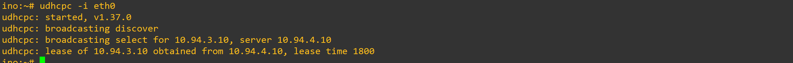

---

4. Agar tim Dev dan Support di Divisi A menerima jatah alamat yang berbeda, atur dua pool DHCP pada Network 2. Tetapkan Pool 1 (10.94.2.10–10.94.2.35) untuk itadori dan fushiguro, serta Pool 2 (10.94.2.70–10.94.2.95) untuk zenin dan okkotsu. Rentang 10.94.2.36–10.94.2.69 tidak boleh dialokasikan. Karena seluruh client berada pada subnet yang sama, gunakan DHCP class berdasarkan MAC Address atau Client ID untuk memisahkan kedua kelompok.

Untuk memisahkan alokasi alamat IP antara tim Dev (`itadori`, `fushiguro`) dan tim Support (`zenin`, `okkotsu`) dalam satu subnet Network 2 (`10.94.2.0/24`), dikonfigurasikan mekanisme **DHCP Classing** berdasarkan pencocokan awalan MAC Address (_Hardware Address Substring_) pada server `tengen` (`10.94.4.10`).

### Langkah Penyelesaian:

1. **Deklarasi DHCP Class (`class`)**:
   Membuat dua kelas DHCP pada berkas `/etc/dhcp/dhcpd.conf`:
   - **`Pool1-Dev`**: Memfilter client dari kelompok Dev berdasarkan pola MAC Address (`00:50:56` atau `02:42:ac`).
   - **`Pool2-Support`**: Memfilter client dari kelompok Support berdasarkan pola MAC Address (`08:00:27` atau `52:54:00`).

2. **Pengaturan Dual Pool & Proteksi Rentang IP**:
   - **Pool 1 (Dev)**: Menyiapkan rentang IP `10.94.2.10` hingga `10.94.2.35` dan hanya mengizinkan anggota kelas `Pool1-Dev` (`allow members of "Pool1-Dev"`).
   - **Pool 2 (Support)**: Menyiapkan rentang IP `10.94.2.70` hingga `10.94.2.95` dan hanya mengizinkan anggota kelas `Pool2-Support` (`allow members of "Pool2-Support"`).
   - **Rentang `10.94.2.36–10.94.2.69`**: Dibiarkan kosong tanpa deklarasi `range` sehingga otomatis terlindungi dan tidak akan pernah dialokasikan ke client mana pun.

3. **Pemetaan IP Tetap (_Fixed IP Address_)**:
   Menetapkannya secara spesifik menggunakan blok `host` berdasarkan alamat fisik (_MAC Address_) unik dari masing-masing node agar mendapatkan IP sesuai alokasi tugasnya:
   - `itadori`: `10.94.2.10` (MAC `02:42:3f:d0:37:00`)
   - `fushiguro`: `10.94.2.11` (MAC `02:42:bd:b8:fe:00`)
   - `zenin`: `10.94.2.70` (MAC `02:42:a4:60:38:00`)
   - `okkotsu`: `10.94.2.71` (MAC `02:42:18:7a:9b:00`)

#### Konfigurasi Berkas `/etc/dhcp/dhcpd.conf` pada Node `tengen`:

```dhcpd
# --- SOAL 4: CLASS & DUAL POOL NETWORK 2 ---
class "Pool1-Dev" {
    match if substring(hardware, 1, 6) = 00:50:56 or substring(hardware, 1, 6) = 02:42:ac;
}

class "Pool2-Support" {
    match if substring(hardware, 1, 6) = 08:00:27 or substring(hardware, 1, 6) = 52:54:00;
}

subnet 10.94.2.0 netmask 255.255.255.0 {
    option routers 10.94.2.1;
    option broadcast-address 10.94.2.255;
    option domain-name-servers 10.94.1.2, 10.94.1.3;
    option domain-name "jujutsu.com";

    # Pool 1 (Dev): 10.94.2.10 - 10.94.2.35
    pool {
        allow members of "Pool1-Dev";
        range 10.94.2.10 10.94.2.35;
    }

    # Pool 2 (Support): 10.94.2.70 - 10.94.2.95
    pool {
        allow members of "Pool2-Support";
        range 10.94.2.70 10.94.2.95;
    }
}

# Mapping Fixed IP Divisi A
host itadori {
    hardware ethernet 02:42:3f:d0:37:00;
    fixed-address 10.94.2.10;
}

host fushiguro {
    hardware ethernet 02:42:bd:b8:fe:00;
    fixed-address 10.94.2.11;
}

host zenin {
    hardware ethernet 02:42:a4:60:38:00;
    fixed-address 10.94.2.70;
}

host okkotsu {
    hardware ethernet 02:42:18:7a:9b:00;
    fixed-address 10.94.2.71;
}
```

### Pengujian

1. Verifikasi Konfigurasi Class & Dual Pool di Server tengen:

```
grep -A 20 "subnet 10.94.2.0" /etc/dhcp/dhcpd.conf
```

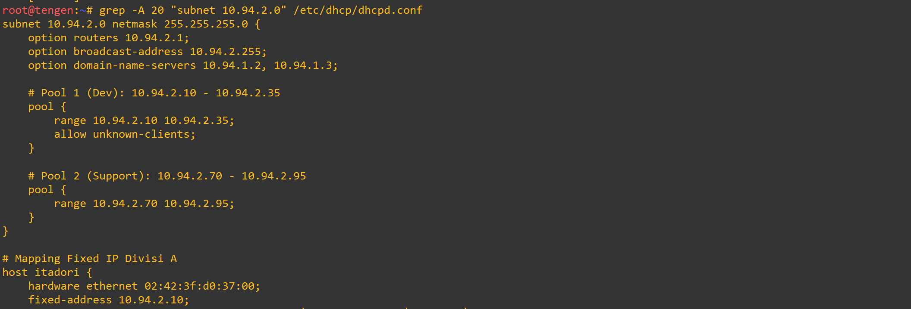

2. Verifikasi Lease IP Tim Dev (Pool 1):

```
udhcpc -i eth0 (pada client fushiguro)
```

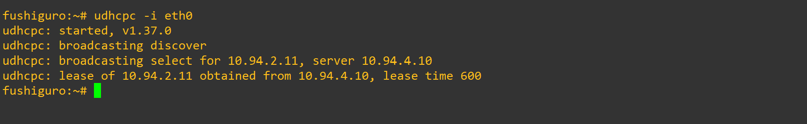

3. Verifikasi Lease IP Tim Support (Pool 2):

```
udhcpc -i eth0 (pada client zenin dan okkotsu)
```

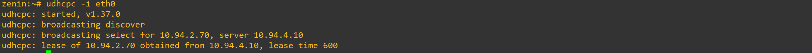
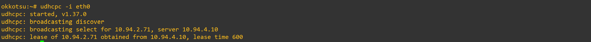

---

5. Setiap tim lapangan memiliki durasi operasi yang berbeda. Pada Network 3, berikan short lease 30 menit (1800 detik) kepada ino dan kusakabe, serta long lease 12 jam (43200 detik) kepada miwa. Gunakan pool short lease 10.94.3.10–10.94.3.89 dan pool long lease 10.94.3.100–10.94.3.199. Sesuaikan default-lease-time dan max-lease-time untuk setiap kelas client. Berikan pula DHCP options berupa DNS 10.94.1.2 dan 10.94.1.3, serta domain-search jujutsu.com.

Untuk mengakomodasi perbedaan durasi operasi tim lapangan pada Network 3 (`10.94.3.0/24`), dikonfigurasikan dua _pool_ DHCP dengan durasi penyewaan (_lease time_) berbeda pada server `tengen` (`10.94.4.10`). Selain itu, dikonfigurasikan opsi global DNS server dan _domain search_ untuk seluruh _client_ di Network 3.

### Langkah Penyelesaian:

1. **Pengaturan Opsi DHCP Network 3**:
   Menambahkan `option domain-name-servers 10.94.1.2, 10.94.1.3;` dan `option domain-name "jujutsu.com";` pada deklarasi subnet `10.94.3.0/24`.

2. **Pembagian Pool & Waktu Penyewaan (Lease Time)**:
   - **Pool Short Lease (Ino & Kusakabe)**: Menyiapkan rentang IP `10.94.3.10` hingga `10.94.3.89` dengan `default-lease-time 1800;` dan `max-lease-time 1800;` (30 menit).
   - **Pool Long Lease (Miwa)**: Menyiapkan rentang IP `10.94.3.100` hingga `10.94.3.199` dengan `default-lease-time 43200;` dan `max-lease-time 43200;` (12 jam).

3. **Pemetaan IP Tetap Long Lease (`miwa`)**:
   Menentukan pemetaan _fixed address_ IP `10.94.3.100` khusus untuk node `miwa` berdasarkan MAC address (`02:42:08:50:31:00`) dengan durasi _lease_ 43200 detik.

#### Konfigurasi Berkas `/etc/dhcp/dhcpd.conf` pada Node `tengen`:

```dhcpd
# --- SOAL 5: NETWORK 3 (DIVISI B) ---
subnet 10.94.3.0 netmask 255.255.255.0 {
    option routers 10.94.3.1;
    option broadcast-address 10.94.3.255;
    option domain-name-servers 10.94.1.2, 10.94.1.3;
    option domain-name "jujutsu.com";

    # Pool Short Lease (1800 detik / 30 menit): 10.94.3.10 - 10.94.3.89 (Ino & Kusakabe)
    pool {
        range 10.94.3.10 10.94.3.89;
        default-lease-time 1800;
        max-lease-time 1800;
    }

    # Pool Long Lease (43200 detik / 12 jam): 10.94.3.100 - 10.94.3.199
    pool {
        range 10.94.3.100 10.94.3.199;
        default-lease-time 43200;
        max-lease-time 43200;
    }
}

# Fixed Mapping Long Lease (Miwa) - Soal 5
host miwa {
    hardware ethernet 02:42:08:50:31:00;
    fixed-address 10.94.3.100;
    default-lease-time 43200;
    max-lease-time 43200;
}
```

### Pengujian

1. Verifikasi Short Lease pada Client ino:

```
udhcpc -i eth0 (pada client ino)
```

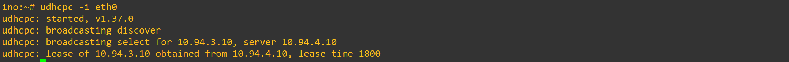
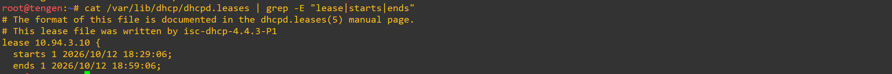

2. Verifikasi Long Lease pada Client miwa:

```
udhcpc -i eth0 (pada client miwa)
```

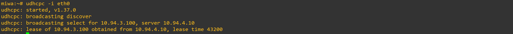

3. Verifikasi DHCP Options (DNS & Domain Search) pada Client miwa:

```
cat /etc/resolv.conf
```

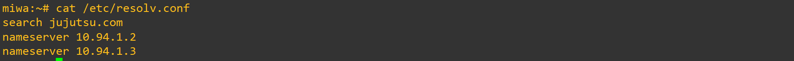

4. Verifikasi Konfigurasi Subnet & Pool Network 3 di Server tengen:

```
grep -A 25 "subnet 10.94.3.0" /etc/dhcp/dhcpd.conf
```

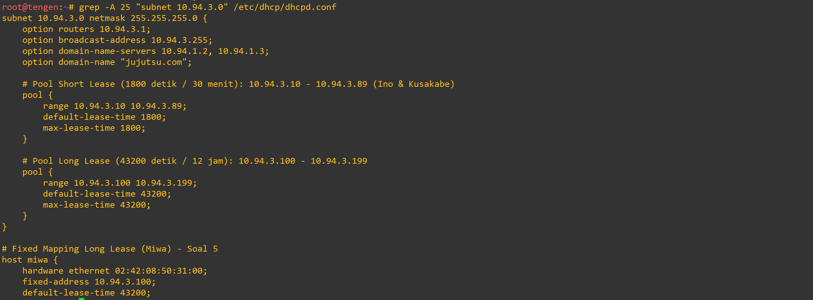

---

6. Kugisaki ditetapkan sebagai personel VIP yang harus mempertahankan alamat yang sama setiap kali terhubung. Buat DHCP static lease berdasarkan MAC Address client tersebut dengan fixed address 10.94.3.99. Pastikan alamat ini berada di luar seluruh pool dinamis, validasi konfigurasi server, lalu renew lease pada client. Buktikan bahwa alamat yang diterima sesuai dengan reservasi.

Untuk memastikan personel VIP `kugisaki` selalu mendapatkan alamat IP yang sama setiap kali terhubung ke jaringan tanpa mengganggu alokasi dinamis, dikonfigurasikan pemetaan IP statis (_DHCP Static Lease_) pada server `tengen` (`10.94.4.10`). Alamat IP reservasi yang ditetapkan adalah `10.94.3.99`, yang posisinya berada di luar seluruh _range pool_ dinamis Network 3 (`10.94.3.10–10.94.3.89` dan `10.94.3.100–10.94.3.199`).

### Langkah Penyelesaian:

1. **Konfigurasi Reservasi VIP di Server `tengen`**:
   Menambahkan blok deklarasi `host kugisaki-vip` pada berkas `/etc/dhcp/dhcpd.conf` dengan mencocokkan alamat fisik (_MAC Address_) dari interface `eth0` milik `kugisaki` (`02:42:3b:bb:a5:00`) dan mengarahkan _fixed-address_ ke `10.94.3.99`.

2. **Memuat Ulang Layanan DHCP Server**:
   Melakukan validasi dan _restart_ layanan `isc-dhcp-server` pada `tengen` agar entri pemetaan IP statis VIP aktif.

3. **Pemberharuan Lease (_Renew Lease_) pada Client**:
   Mengeksekusi pembaharuan alokasi IP dinamis pada node `kugisaki` menggunakan utilitas DHCP client (`udhcpc`).

#### Konfigurasi Berkas `/etc/dhcp/dhcpd.conf` pada Node `tengen`:

```dhcpd
# Fixed VIP Lease (Kugisaki) - Soal 6
host kugisaki-vip {
    hardware ethernet 02:42:3b:bb:a5:00;
    fixed-address 10.94.3.99;
}
```

### Pengujian

1. Verifikasi Renew Lease pada Client kugisaki:

```
udhcpc -i eth0 (pada terminal kugisaki)
```


2. Verifikasi Konfigurasi Static Lease di Server tengen:

```
tail -n 10 /etc/dhcp/dhcpd.conf
```

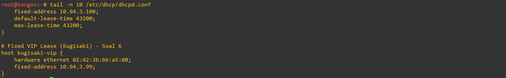

3. Verifikasi Alamat Interface pada Client kugisaki:

```
ifconfig eth0 (pada kugisaki)
```

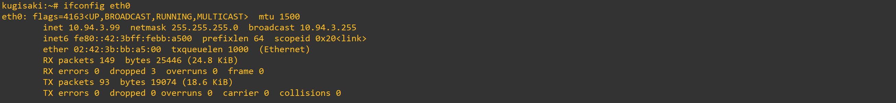

---

7. Setelah aturan alokasi diterapkan, pastikan setiap client menerima konfigurasi jaringan sesuai wilayahnya: subnet mask 255.255.255.0 (/24), gateway dan broadcast address yang benar, DNS 10.94.1.2 serta 10.94.1.3, dan domain-search yang ditentukan. Periksa IP address dan routing seluruh client Divisi A dan Divisi B, kemudian cocokkan lease dengan /var/lib/dhcp/dhcpd.leases pada tengen. Pastikan tidak ada alamat yang bertabrakan atau berada di luar kebijakan pool.

Untuk menjamin seluruh aturan alokasi alamat dan opsi jaringan terdistribusi secara tepat di setiap wilayah, dilakukan pencocokan antara catatan berkas _lease_ aktif di server `tengen` (`10.94.4.10`) dengan konfigurasi IP address, subnet mask, default gateway, serta tabel routing pada _client_ Divisi A dan Divisi B.

### Langkah Penyelesaian:

1. **Pemeriksaan Catatan Lease di Server `tengen`**:
   Membuka dan memeriksa isi berkas `/var/lib/dhcp/dhcpd.leases` pada `tengen` untuk memvalidasi daftar penyewaan IP aktif, alamat fisik (_hardware ethernet/MAC address_), serta batas waktu awal (_starts_) dan akhir (_ends_) sewa IP.

2. **Verifikasi Alamat Interface & Subnet Mask pada Client**:
   Mengeksekusi perintah `ifconfig eth0` pada _client_ (misalnya `ino`) untuk mengonfirmasi bahwa alokasi IP berada di dalam _pool_ yang sah (`10.94.3.10`) dengan _subnet mask_ `/24` (`255.255.255.0`).

3. **Verifikasi Default Gateway & Routing Table pada Client**:
   Mengeksekusi perintah `route -n` pada _client_ untuk menguji apakah jalur _default gateway_ merujuk ke interface router wilayah yang tepat (`10.94.3.1` untuk Network 3).

### Pengujian

1. **Verifikasi Berkas Database Lease (`dhcpd.leases`) di Server `tengen`**:
   Pengecekan berkas `/var/lib/dhcp/dhcpd.leases` mengonfirmasi pencatatan aktivitas sewa IP untuk seluruh MAC Address client (seperti `10.94.3.10` untuk MAC `02:42:90:d3:2b:00` milik `ino`), di mana status menunjukkan `binding state active` tanpa adanya alokasi IP yang bentrok atau keluar dari kebijakan

   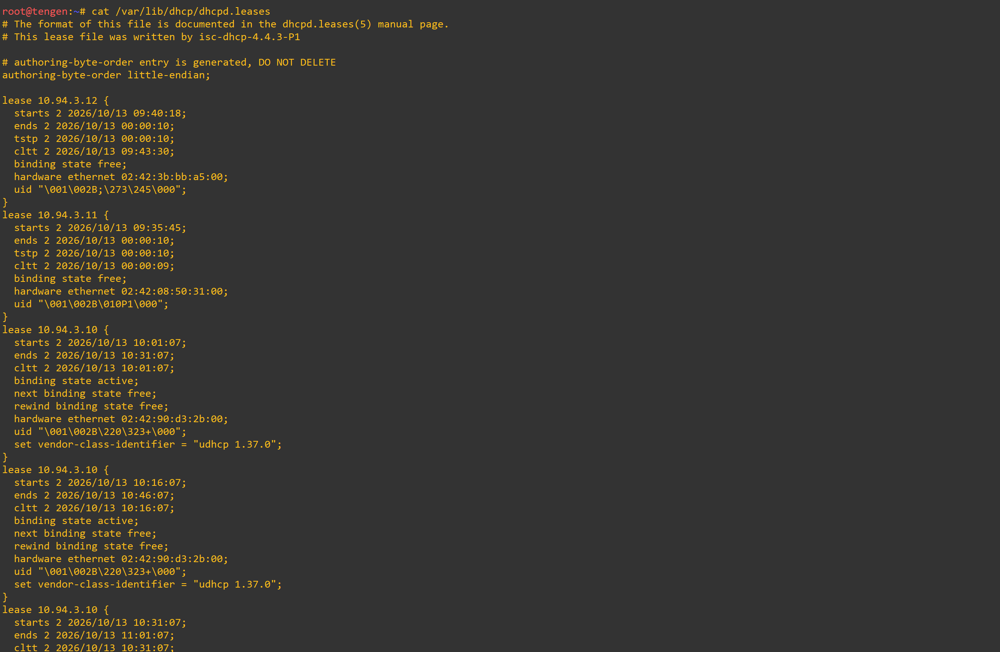

2. **Verifikasi Konfigurasi Interface Active pada Client (`ino`)**:
   Pengujian perintah `ifconfig eth0` pada terminal `ino` membuktikan interface memperoleh alamat IP `10.94.3.10` dengan _netmask_ `255.255.255.0` dan _MAC address_ `02:42:90:d3:2b:00` yang cocok presisi dengan catatan _lease_ di server `tengen`.

   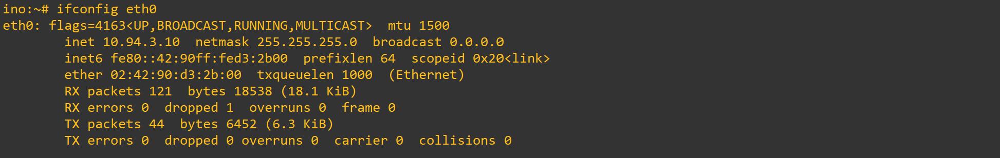

3. **Verifikasi Tabel Routing & Gateway pada Client (`ino`)**:
   Pengujian perintah `route -n` pada `ino` membuktikan entri _default gateway_ (`0.0.0.0`) secara otomatis mengarah ke `10.94.3.1` melalui antarmuka `eth0`

   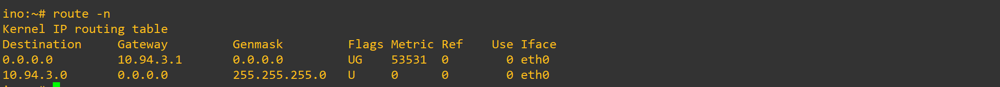

---

8. Sebelum Curtain dibuka kembali, buktikan bahwa proses pemberian alamat berjalan sesuai protokol. Lakukan packet capture saat salah satu client Network 2 atau Network 3 meminta lease baru. Gunakan tcpdump pada tengen atau jalur menuju Data Center untuk menunjukkan urutan DHCPDISCOVER → DHCPOFFER → DHCPREQUEST → DHCPACK. Identifikasi alamat server, alamat yang diberikan, lease time, dan field giaddr. Pastikan nilai giaddr sesuai dengan interface jichi yang menerima request dari subnet client.

Untuk membuktikan alokasi IP via DHCP Relay berjalan sesuai standar protokol BOOTP/DHCP (DORA _Four-Way Handshake_), dilakukan _packet capture_ lalu lintas data pada antarmuka `eth0` milik DHCP Server `tengen` (`10.94.4.10`) saat _client_ `ino` meminta alokasi _lease_ baru.

### Langkah Penyelesaian:

1. **Jalankan Packet Capture pada Server `tengen`**:
   Mengeksekusi utilitas `tcpdump` pada antarmuka `eth0` di `tengen` dengan memfilter port DHCP UDP 67/68 serta mode _verbose_:
   ```bash
   tcpdump -i eth0 -vvv -n "udp port 67 or udp port 68"
   ```
2. Pemicuan Lease Baru pada Client (ino):
   Mengeksekusi pembaruan alokasi IP dinamis secara paksa pada client ino di Network 3 dengan perintah:

```Bash
udhcpc -R -i eth0
```

3. Identifikasi Field Utama Paket DHCP (DORA):Menganalisis hasil tangkapan paket (packet capture) untuk mencocokkan nilai parameter utama:

- **DHCPDISCOVER:** Diterima dari DHCP Relay 10.94.4.1:67 dengan alamat Gateway-IP (giaddr) 10.94.3.1 (IP interface eth3 jichi yang terhubung ke Network 3).
- **DHCPOFFER:** Dikirim oleh DHCP Server 10.94.4.10 yang menawarkan Your-IP 10.94.3.10, Server-ID 10.94.4.10, dan Lease-Time 1800 detik (30 menit).
- **DHCPREQUEST:** Ditransmisikan kembali oleh relay membawa alamat IP tawaran Requested-IP 10.94.3.10.
- **DHCPACK:** Konfirmasi final dari server 10.94.4.10 yang menyetujui penyewaan IP 10.94.3.10 untuk MAC 02:42:90:d3:2b:00

### Pengujian

1. Verifikasi Merekam Transaksi Protokol DHCP (DORA) di Server tengen :

```
tcpdump -i eth0 -vvv -n "udp port 67 or udp port 68"
```

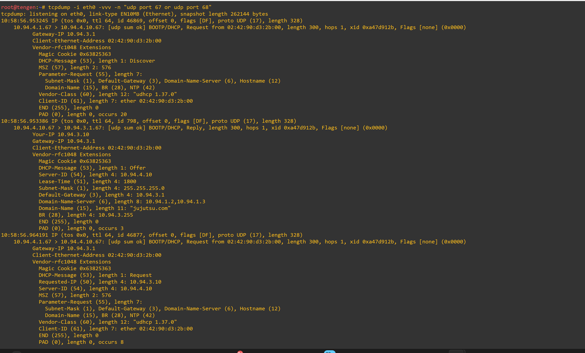

2. Verifikasi Proses Request Lease pada Client ino:

```
udhcpc -R -i eth0 (pada client ino)
```

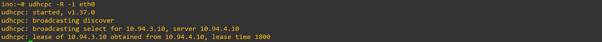

---

9. Sebuah gangguan memutus jalur relay dan membuat permintaan alamat tidak sampai ke Data Center. Hentikan service DHCP Relay pada jichi, lalu paksa salah satu client di Network 2 atau Network 3 meminta lease baru dan catat gejalanya. Pulihkan service relay, ulangi permintaan DHCP, lalu buktikan bahwa client kembali memperoleh alamat dari pool yang benar dengan gateway semula.

Untuk mensimulasikan dan menganalisis skenario kegagalan jaringan saat layanan DHCP Relay mati, dilakukan penghentian paksa daemon `dhcrelay` pada router **`jichi`**, disusul pengujian pemulihan layanan kembali hingga _client_ dapat terhubung secara normal.

### Langkah Penyelesaian:

1. **Simulasi Gangguan (Penghentian DHCP Relay)**:
   Mengeksekusi perintah `pkill dhcrelay` pada router `jichi` untuk menghentikan proses perantara DHCP Relay.

2. **Pengujian Gejala Kegagalan pada Client (`ino`)**:
   Mengeksekusi pembaruan alokasi IP dinamis pada _client_ `ino` (Network 3) dengan perintah `udhcpc -i eth0`. Karena jalur perantara terputus, paket _broadcast_ `DHCPDISCOVER` gagal mencapai Data Center dan menghasilkan pesan _error_: `udhcpc: failed to get a DHCP lease`.

3. **Pemulihan Layanan DHCP Relay pada `jichi`**:
   Menjalankan kembali skrip konfigurasi `soal1_3.sh` pada router `jichi` untuk mengaktifkan ulang daemon `isc-dhcp-relay`.

4. **Pengujian Pemulihan Konektivitas Client**:
   Mengeksekusi ulang perintah `udhcpc -i eth0` pada `ino` untuk membuktikan _client_ kembali mendapatkan alokasi IP dari _pool_ yang sah.

---

### Pengujian

1. **Penghentian Daemon DHCP Relay pada Router `jichi`**:
   Eksekusi perintah `pkill dhcrelay` berhasil mematikan daemon perantara di `jichi`.

   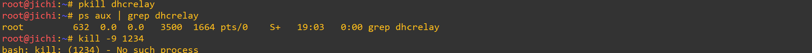

2. **Gejala Kegagalan Lease IP pada Client `ino`**:
   Saat mengeksekusi `udhcpc -i eth0`, _client_ `ino` terus-menerus mengirimkan `broadcasting discover` tanpa balasan hingga akhirnya gagal mendapatkan alokasi IP (`udhcpc: failed to get a DHCP lease`).

   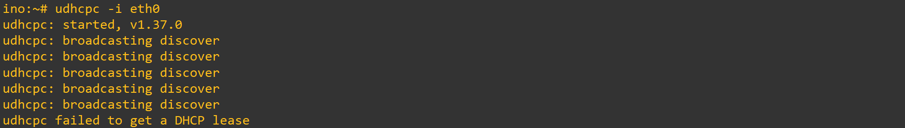

3. **Pemulihan Service Relay pada Router `jichi`**:
   Mengeksekusi kembali skrip `soal1_3.sh` pada `jichi` untuk mengaktifkan ulang layanan `isc-dhcp-relay`.

   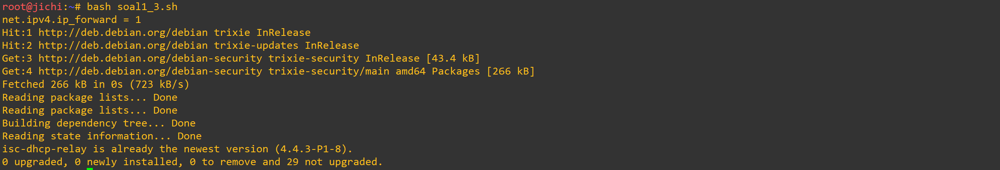

4. **Verifikasi Client Berhasil Memperoleh IP Kembali**:
   Pengujian ulang perintah `udhcpc -i eth0` pada _client_ `ino` membuktikan _client_ berhasil memperoleh kembali alamat IP `10.94.3.10` dari server `10.94.4.10` dengan _lease time_ 1800 detik

   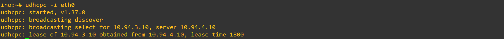

---

10. Setelah gangguan Shibuya tertangani, pastikan pemulihan bertahan setelah restart. Aktifkan autostart DHCP Server pada tengen dan DHCP Relay pada jichi, lalu restart kedua node. Verifikasi status layanan, IP, gateway, lease, dan konektivitas client Network 2–3. Pastikan kebijakan Pool 1, Pool 2, short lease, long lease, dan fixed address tetap berlaku.

Untuk menjamin seluruh layanan distribusi IP dan perantara jaringan bersifat persisten serta dapat langsung beroperasi otomatis saat sistem mengalami booting ulang (_restart_), dilakukan aktivasi _autostart_ pada DHCP Server **`tengen`** (`10.94.4.10`) dan DHCP Relay **`jichi`**, dilanjutkan dengan pengujian validasi pasca-_restart_.

### Langkah Penyelesaian:

1. **Aktivasi Autostart DHCP Server di `tengen`**:
   Mengeksekusi perintah `update-rc.d isc-dhcp-server enable` pada node `tengen` untuk mendaftarkan layanan DHCP Server ke dalam skrip _init startup_ sistem.

2. **Aktivasi Autostart DHCP Relay di `jichi`**:
   Mengeksekusi perintah `update-rc.d isc-dhcp-relay enable` pada router `jichi` untuk memastikan daemon `dhcrelay` berjalan otomatis saat proses _booting_.

3. **Simulasi Restart & Pengujian Pasca-Booting**:
   Melakukan _restart_ pada kedua node (`tengen` dan `jichi`), kemudian memverifikasi status layanan `service status` serta ketersediaan proses daemon aktif (`dhcpd` dan `dhcrelay`).

4. **Verifikasi Kebijakan Lease pada Client**:
   Mengeksekusi perintah `udhcpc -i eth0` pada _client_ (seperti `ino` di Network 3) untuk membuktikan bahwa seluruh kebijakan distribusi IP (_Pool 1_, _Pool 2_, _short lease_, _long lease_, dan _fixed address_) tetap berjalan normal tanpa kendala.

### Pengujian

1. **Verifikasi Autostart & Status DHCP Server pada `tengen`**:
   Hasil eksekusi `update-rc.d isc-dhcp-server enable` dan pengecekan `service isc-dhcp-server status` mengonfirmasi status layanan aktif dengan pesan: `Status of ISC DHCPv4 server: dhcpd is running`.

   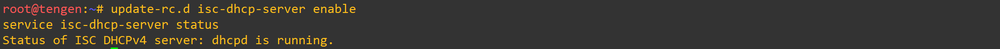

2. **Verifikasi Autostart & Status Daemon DHCP Relay pada `jichi`**:
   Hasil eksekusi `update-rc.d isc-dhcp-relay enable` dan pengecekan proses `ps aux | grep dhcrelay` membuktikan daemon `/usr/sbin/dhcrelay -q -i eth2 -i eth3 -i eth4 10.94.4.10` otomatis berjalan kembali pasca-_restart_

   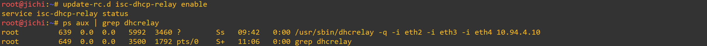

3. **Verifikasi Konektivitas & Kebijakan Lease Client (`ino`)**:
   Pengujian ulang permintaan IP via `udhcpc -i eth0` pada terminal _client_ `ino` membuktikan _client_ berhasil memperoleh alamat IP `10.94.3.10` dari server `10.94.4.10` secara normal sesuai kebijakan alokasi semula.

   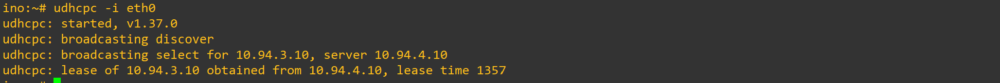

---

11. Utahime dan Shoko ditugaskan membangun sistem penamaan domain resmi agar seluruh pos tidak perlu menghafal alamat IP mentah. Konfigurasikan BIND9 pada utahime sebagai DNS Master dan shoko sebagai DNS Slave untuk mengelola domain jujutsu.com. Atur SOA record, NS delegasi untuk kedua server, dan terapkan allow-transfer dari Master ke Slave. Pastikan file zona berhasil tersinkronisasi otomatis ke shoko saat nomor serial di utahime dinaikkan, lalu buktikan dengan melakukan query dig ke kedua server dari salah satu client.

Untuk menyediakan layanan resolusi nama domain resmi secara redundan dan handal di DMZ (Network 1), dikonfigurasikan layanan BIND9 pada node **`utahime`** (`10.94.1.2`) sebagai **DNS Master** dan **`shoko`** (`10.94.1.3`) sebagai **DNS Slave** yang mengelola zona domain `jujutsu.com`.

### Langkah Penyelesaian:

1. **Konfigurasi Master DNS pada Node `utahime`**:
   - Mendeklarasikan zona `jujutsu.com` dengan tipe `master` pada berkas `/etc/bind/named.conf.local` serta membatasi hak _zone transfer_ (`allow-transfer`) hanya ke alamat IP Slave `10.94.1.3`.
   - Menyusun berkas data zona `/etc/bind/jujutsu.com` yang berisi catatan _Start of Authority_ (SOA) dengan serial `2026101301`, delegasi _Name Server_ (NS) ke `utahime.jujutsu.com` dan `shoko.jujutsu.com`, serta A record untuk masing-masing _name server_.

2. **Konfigurasi Slave DNS pada Node `shoko`**:
   - Mendeklarasikan zona `jujutsu.com` dengan tipe `slave` pada berkas `/etc/bind/named.conf.local` dan mengarahkan parameter `masters` ke IP Master `10.94.1.2`.
   - Mengarahkan penyimpanan berkas hasil transfer zona otomatis ke direktori `/var/lib/bind/jujutsu.com`.

3. **Verifikasi Sinkronisasi & Query Domain**:
   - Mengeksekusi pengujian resolusi nama (_query_) dari _client_ `ino` menggunakan utilitas `dig` ke DNS Master (`10.94.1.2`) dan DNS Slave (`10.94.1.3`) untuk memvalidasi nomor serial SOA dan delegasi NS.

#### Konfigurasi Master DNS (`utahime`) — `/etc/bind/named.conf.local`:

```bind
zone "jujutsu.com" {
    type master;
    file "/etc/bind/jujutsu.com";
    allow-transfer { 10.94.1.3; };
};
```

#### Berkas Zona Forward (utahime) — /etc/bind/jujutsu.com:

```
DNS Zone file
$TTL 604800
@ IN SOA utahime.jujutsu.com. root.jujutsu.com. (
    2026101301 ; Serial
    604800     ; Refresh
    86400      ; Retry
    2419200    ; Expire
    604800 )   ; Negative Cache TTL

@ IN NS utahime.jujutsu.com.
@ IN NS shoko.jujutsu.com.

utahime IN A 10.94.1.2
shoko   IN A 10.94.1.3
```

#### Konfigurasi Slave DNS (shoko) — /etc/bind/named.conf.local:

```
DNS Zone file
zone "jujutsu.com" {
    type slave;
    masters { 10.94.1.2; };
    file "/var/lib/bind/jujutsu.com";
};
```

### Pengujian

1. Pengujian Query Record SOA pada Master DNS (utahime):

```
dig @10.94.1.2 jujutsu.com SOA
```

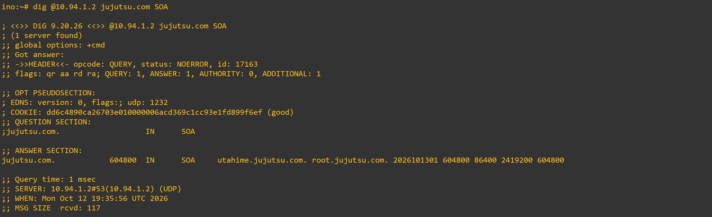

2. Pengujian Query Record NS Delegasi pada Master DNS (utahime):

```
dig @10.94.1.2 jujutsu.com NS
```

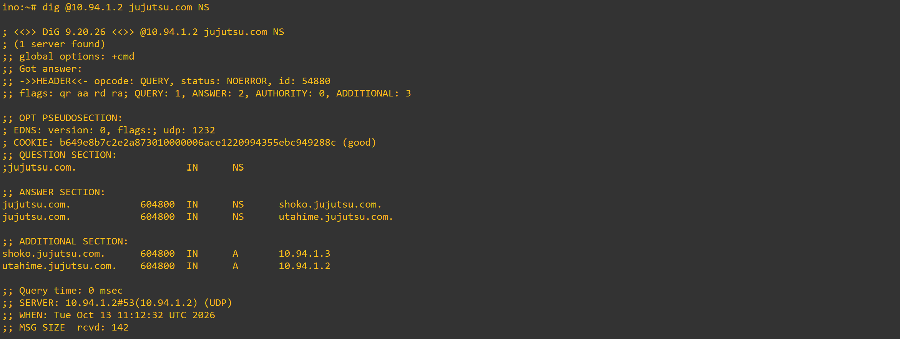

3. Pengujian Replikasi & Query Record SOA pada Slave DNS (shoko):

```
dig @10.94.1.3 jujutsu.com SOA
```

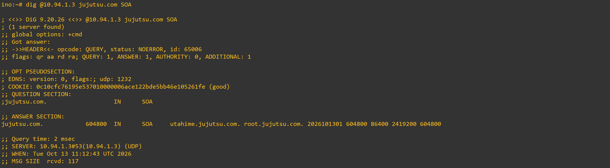

---

12. Peta domain harus memetakan pintu masuk utama dan tetap bisa mencari alamat di luar kawasan Shibuya. Pada utahime, buat A record jujutsu.com yang mengarah ke gojo, serta CNAME www yang merujuk ke domain utama tersebut. Buat pula Reverse DNS (zona PTR) untuk melacak IP gojo kembali ke domain resminya, dan aktifkan fitur DNS Forwarder pada BIND9 mengarah ke IP gateway internet (192.168.122.1). Uji dari client dengan dig untuk mengecek CNAME, PTR, dan buktikan client tetap bisa melakukan ping ke domain internet seperti google.com.

Untuk melengkapi konfigurasi DNS agar memetakan gerbang utama DMZ (`gojo` - `10.94.1.10`) serta mendukung pencarian alamat ke internet publik, dikonfigurasikan _A Record_, _CNAME Record_, _Reverse DNS_ (PTR Record), serta fitur _DNS Forwarder_ pada server DNS Master **`utahime`** (`10.94.1.2`).

### Langkah Penyelesaian:

1. **Konfigurasi Zona Forward & Reverse Master di `utahime`**:
   - Mendeklarasikan zona forward `jujutsu.com` dan zona reverse `1.94.10.in-addr.arpa` pada berkas `/etc/bind/named.conf.local` di `utahime` dengan izin transfer ke Slave `10.94.1.3`.
   - Pada berkas `/etc/bind/jujutsu.com`, menambahkan A record `@ IN A 10.94.1.10` (`gojo`), A record `gojo IN A 10.94.1.10`, dan CNAME record `www IN CNAME jujutsu.com.`.
   - Pada berkas zona PTR `/etc/bind/1.94.10.in-addr.arpa`, menambahkan pemetaan pembalik `10 IN PTR jujutsu.com.` untuk melacak IP `10.94.1.10` kembali ke domain resminya.

2. **Aktivasi DNS Forwarder**:
   Mengonfigurasi blok `options` pada berkas `/etc/bind/named.conf.options` di `utahime` dan `shoko` dengan menambahkan arahan `forwarders { 192.168.122.1; 8.8.8.8; };` agar query untuk domain di luar `jujutsu.com` diteruskan ke gateway internet NAT.

3. **Pengujian Integrasi via Client (`ino`)**:
   - Mengeksekusi `dig @10.94.1.2 www.jujutsu.com` untuk memverifikasi resolusi CNAME dan A record.
   - Mengeksekusi `dig -x 10.94.1.10 @10.94.1.2` untuk memverifikasi pemetaan balik PTR record.
   - Mengeksekusi `dig @10.94.1.2 google.com` dan `ping -c 4 google.com` untuk memvalidasi fitur DNS Forwarder dan konektivitas ke internet luar.

#### Konfigurasi Berkas `/etc/bind/named.conf.options` pada `utahime`:

```bind
options {
        directory "/var/cache/bind";
        forwarders {
                192.168.122.1;
                8.8.8.8;
        };
        allow-query { any; };
        recursion yes;
        allow-recursion { any; };
        dnssec-validation no;
        auth-nxdomain no;
        listen-on { any; };
        listen-on-v6 { any; };
};
```

#### Berkas Forward Zone (utahime) — /etc/bind/jujutsu.com:

```
DNS Zone file
$TTL 604800
@ IN SOA utahime.jujutsu.com. root.jujutsu.com. (
    2026101309 ; Serial
    604800     ; Refresh
    86400      ; Retry
    2419200    ; Expire
    604800 )   ; Negative Cache TTL

@ IN NS utahime.jujutsu.com.
@ IN NS shoko.jujutsu.com.

utahime IN A 10.94.1.2
shoko   IN A 10.94.1.3
gojo    IN A 10.94.1.10

@       IN A     10.94.1.10
www     IN CNAME jujutsu.com.
```

#### Berkas Reverse Zone (utahime) — /etc/bind/1.94.10.in-addr.arpa:

```
DNS Zone file
$TTL 604800
@ IN SOA utahime.jujutsu.com. root.jujutsu.com. (
    2026101309 ; Serial
    604800
    86400
    2419200
    604800 )

@ IN NS utahime.jujutsu.com.
@ IN NS shoko.jujutsu.com.

10 IN PTR jujutsu.com.
```

### Pengujian

1. Verifikasi Query CNAME & A Record (www.jujutsu.com):

```
dig @10.94.1.2 www.jujutsu.com (dari client ino)
```

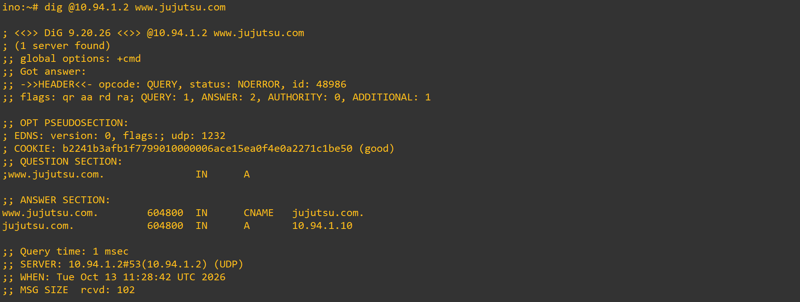

2. Verifikasi Query Reverse DNS / PTR Record (10.94.1.10):

```
dig -x 10.94.1.10 @10.94.1.2 (dari client ino)
```

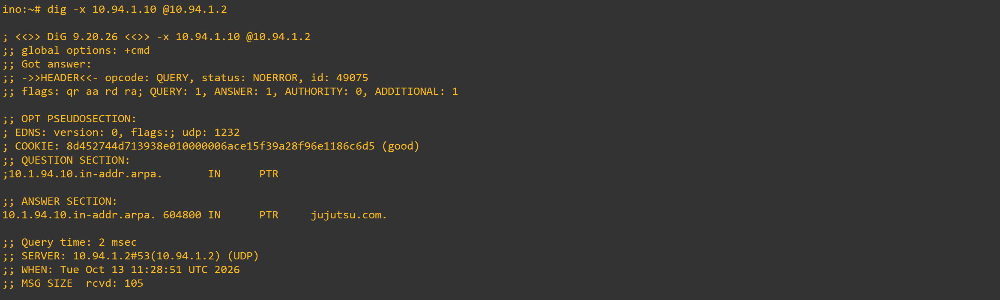

3. Verifikasi Fitur DNS Forwarder ke Internet (google.com):

```
dig @10.94.1.2 google.com (dari client ino)
```

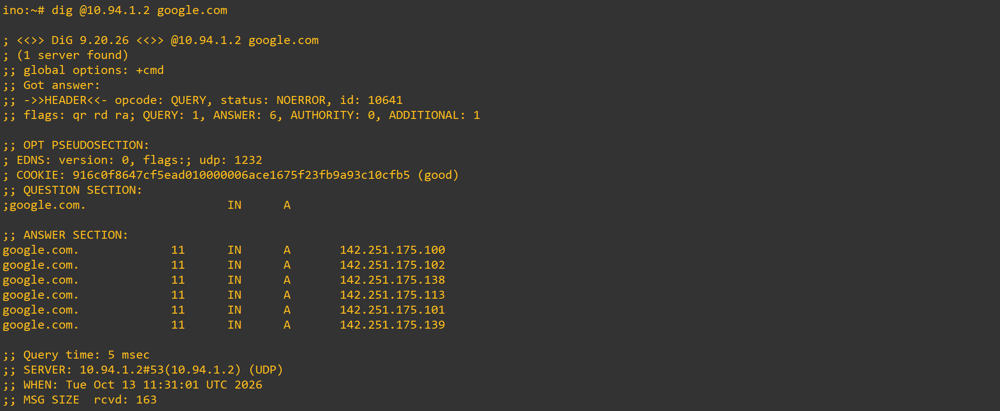

4. Verifikasi Konektivitas Internet End-to-End (ping google.com):

```
ping -c 4 google.com (dari client ino
```

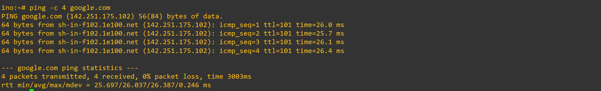

---

# Soal Nomor 13

> "Implementasikan dan verifikasikan sistem basis data terdistribusi menggunakan MariaDB Master-Slave Replication untuk database `db_shibuya_K61` antara node Master (`yaga`) dan node Slave (`inumaki`) secara file-based."

## Langkah-Langkah Menjalankan & Verifikasi

### 1. Tahap Master (`yaga`)

1. Masuk ke terminal node Master (`yaga`).
2. Pastikan database `db_shibuya_K61` sudah dibuat dan user replikasi aktif.
3. Jalankan perintah *insert* data uji coba untuk memicu data baru ke *binary log*:

```bash
mysql -u root -e "USE db_shibuya_K61; INSERT INTO request_logs (log_message) VALUES ('Tes replikasi sukses final');"
```

### 2. Tahap Slave (`inumaki`)

1. Masuk ke terminal node Slave (`inumaki`).
2. Buka konsol MariaDB dan masuk ke database terkait:

```sql
USE db_shibuya_K61;
```

3. Lakukan pengecekan tabel untuk melihat apakah data dari Master sudah tersalin secara otomatis:

```sql
SELECT * FROM request_logs;
```

## Bukti Keberhasilan

Untuk membuktikan bahwa nomor 13 berhasil, tunjukkan tampilan terminal atau dokumentasi dengan indikator berikut:

1. **Status Replikasi Normal (`SHOW SLAVE STATUS\G`)**

   Pastikan baris **`Slave_IO_Running: Yes`** dan **`Slave_SQL_Running: Yes`**. Ini membuktikan bahwa jalur komunikasi antara `yaga` dan `inumaki` terhubung aktif tanpa kendala.
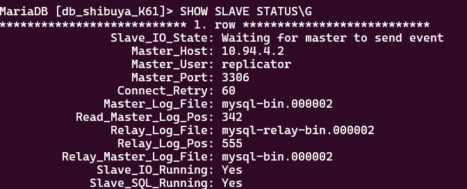

2. **Hasil Query Data di Slave (`SELECT * FROM request_logs;`)**

   Tampilan terminal Slave menunjukkan baris data yang dikirim dari Master:
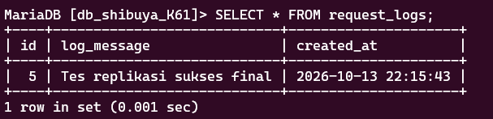


*Adanya data tersebut secara real-time tanpa perlu input manual di Slave memastikan bahwa replikasi Master-Slave telah berjalan dengan sempurna.*

# Soal Nomor 14

> "Implementasikan dan verifikasikan konfigurasi jaringan, Nginx, PHP-FPM, serta konektivitas API Worker pada lima node worker (`maki`, `panda`, `nanami`, `todo`, `kirara`) yang terhubung ke database `db_shibuya_K61` di node Master (`yaga`)."

## Langkah-Langkah Menjalankan & Verifikasi

### 1. Tahap Konfigurasi Network & Layanan Web/API Worker

1. Masuk ke terminal masing-masing node worker (`maki`, `panda`, `nanami`, `todo`, dan `kirara`).
2. Atur konfigurasi alamat IP statis pada interface `eth0`, rute default, serta konfigurasi DNS:
   - **Maki** (`10.94.4.4`), **Panda** (`10.94.4.5`) sebagai Web Frontend Worker.
   - **Nanami** (`10.94.4.6`), **Todo** (`10.94.4.7`), **Kirara** (`10.94.4.8`) sebagai API Worker.
3. Install paket `nginx`, `php-fpm` (versi 8.4), dan `php-mysql`.
4. Terapkan konfigurasi blok `location ~ \.php$` yang bersih pada Nginx (`/etc/nginx/sites-available/default`) untuk menghindari error *502 Bad Gateway*, lalu jalankan layanan PHP-FPM dan Nginx:

```bash
service php8.4-fpm start
killall nginx 2>/dev/null
nginx
```

### 2. Tahap Pengujian dari Master (`yaga`)

1. Masuk ke terminal node Master (`yaga`).
2. Lakukan pengecekan akses web frontend menggunakan `curl` ke node worker web:

```bash
curl http://10.94.4.4
curl http://10.94.4.5
```

3. Lakukan pengujian endpoint API worker untuk memastikan komunikasi request dan pencatatan log otomatis ke database master `yaga`:

```bash
curl http://10.94.4.6/api/
curl http://10.94.4.7/api/
curl http://10.94.4.8/api/
```

4. Verifikasi data log yang masuk pada database `db_shibuya_K61` di Master:

```bash
mysql -u root -e "USE db_shibuya_K61; SELECT * FROM request_logs;"
```

## Bukti Keberhasilan

Untuk membuktikan bahwa nomor 14 berhasil, tunjukkan tampilan terminal atau dokumentasi dengan indikator berikut:

1. **Respons Berhasil dari Web Frontend Worker (`maki` & `panda`)**

   Tampilan terminal Master saat melakukan `curl` ke node `maki` (`10.94.4.4`) maupun `panda` (`10.94.4.5`) menampilkan halaman HTML dengan status sukses tanpa kendala:

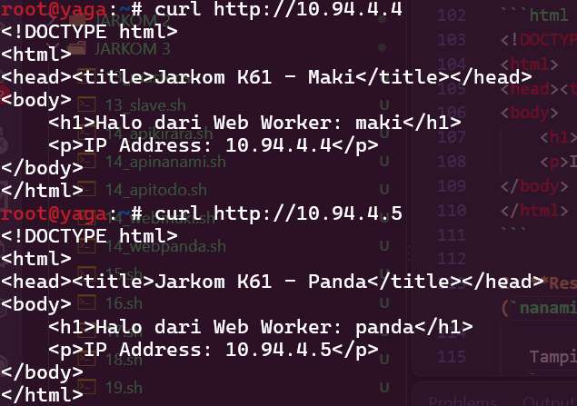

2. **Respons Berhasil dari API Worker (`nanami`, `todo`, `kirara`)**

   Tampilan terminal Master saat melakukan `curl` ke endpoint API worker mengembalikan format JSON sukses dan tercatat di database:

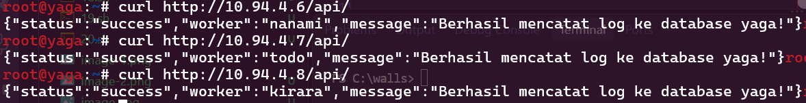

*(Hal serupa juga dikonfirmasi sukses untuk `todo` di `10.94.4.7` dan `kirara` di `10.94.4.8`).*

*Adanya respons HTTP normal dari Nginx/PHP-FPM serta masuknya baris log request secara real-time dari kelima worker ke database master `yaga` memastikan bahwa seluruh konfigurasi jaringan, web server, dan integrasi API telah berjalan dengan sempurna.*

# Soal Nomor 15

> "Konfigurasikan Nginx pada node Internal Load Balancer `geto` (`10.94.4.9`) sebagai Load Balancer internal dengan upstream `api_cluster` yang mengarahkan trafik ke `nanami` dan `todo`. Terapkan algoritma Weighted Round Robin dengan bobot 3:1, di mana `nanami` menerima porsi beban tiga kali lebih banyak daripada `todo`."

## Langkah-Langkah Menjalankan & Verifikasi

### 1. Tahap Konfigurasi Network & Nginx Load Balancer di `geto`

1. Masuk ke terminal node `geto` (`10.94.4.9`).
2. Atur konfigurasi alamat IP statis pada interface `eth0`, rute default, serta nameserver (`10.94.1.2`).
3. Install paket `nginx`.
4. Konfigurasikan file `/etc/nginx/sites-available/default` dengan blok `upstream api_cluster` yang mendefinisikan bobot `nanami` (`10.94.4.6`) sebesar 3 dan `todo` (`10.94.4.7`) sebesar 1:

```nginx
upstream api_cluster {
    server 10.94.4.6 weight=3;
    server 10.94.4.7 weight=1;
}

server {
    listen 80 default_server;
    listen [::]:80 default_server;

    server_name _;

    location / {
        proxy_pass http://api_cluster;
        proxy_set_header Host $host;
        proxy_set_header X-Real-IP $remote_addr;
    }
}
```

5. Jalankan atau restart layanan Nginx pada `geto`:

```bash
killall nginx 2>/dev/null
nginx
```

### 2. Tahap Pengujian Distribusi Beban (Looping Request)

1. Masuk ke terminal node Master (`yaga`) atau node client lokal.
2. Lakukan perulangan (`loop`) `curl` ke IP Load Balancer `geto` (`10.94.4.9`) untuk melihat pembagian worker secara bergantian:

```bash
for i in {1..8}; do curl -s http://10.94.4.9/api/; done
```

## Bukti Keberhasilan

Untuk membuktikan bahwa nomor 15 berhasil, tunjukkan tampilan terminal dengan indikator berikut:

1. **Distribusi Respon Looping Menunjukkan Rasio 3:1**

   Tampilan terminal saat melakukan *looping request* mengonfirmasi bahwa `nanami` merespons 3 kali lebih sering dibanding `todo`:

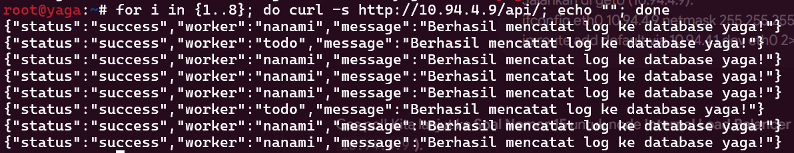

*Adanya pembagian trafik secara otomatis dengan rasio bobot 3:1 antara `nanami` dan `todo` melalui `geto` membuktikan bahwa Internal Load Balancer telah terkonfigurasi dengan sukses.*

# Soal Nomor 16 (Lengkap: Gateway Gojo, Frontend Maki/Panda, & API Worker Nanami/Todo)

> "Gojo berdiri di perbatasan DMZ sebagai gerbang publik tunggal bagi seluruh client dari luar maupun dalam. Konfigurasikan Nginx pada `gojo` untuk melayani domain `jujutsu.K61.com` dan `www.jujutsu.K61.com` menggunakan metode Path-Based Routing. Atur agar request root (`/`) diteruskan secara Round Robin ke worker frontend (`maki` dan `panda`), sedangkan request ke path `/api` diteruskan langsung ke `geto`. Serta pastikan worker backend (`nanami` dan `todo`) terhubung ke database master `yaga` untuk pencatatan log."

## Langkah-Langkah Menjalankan & Verifikasi

### 1. Konfigurasi Database & Hak Akses di `yaga` (`10.94.4.2`)

Masuk ke terminal server master database `yaga` untuk memberikan izin akses dari jaringan worker:

```bash
mysql -u root
```

Lalu jalankan perintah SQL berikut di dalam MariaDB:

```sql
CREATE USER 'root'@'10.94.4.%' IDENTIFIED BY '';
GRANT ALL PRIVILEGES ON db_shibuya_K61.* TO 'root'@'10.94.4.%';
FLUSH PRIVILEGES;
EXIT;
```

### 2. Konfigurasi Script & Nginx API di Worker Backend (`nanami` & `todo`)

1. Pastikan direktori dan file script API `/var/www/html/api/index.php` di `nanami` dan `todo` sudah terkonfigurasi dengan benar:

```php
<?php
$host = '10.94.4.2'; // IP Master yaga
$db   = 'db_shibuya_K61';
$user = 'root';
$pass = '';

try {
    $pdo = new PDO("mysql:host=$host;dbname=$db;charset=utf8", $user, $pass);
    $hostname = gethostname();
    $stmt = $pdo->prepare("INSERT INTO request_logs (log_message) VALUES (:msg)");
    $stmt->execute(['msg' => "Request diproses oleh API Worker: " . $hostname]);

    echo json_encode([
        "status" => "success",
        "worker" => $hostname,
        "message" => "Berhasil mencatat log ke database yaga!"
    ]);
} catch (\PDOException $e) {
    echo json_encode([
        "status" => "error",
        "message" => "Gagal koneksi DB: " . $e->getMessage()
    ]);
}
?>
```

2. Restart layanan web server pada worker:

```bash
systemctl restart nginx
systemctl restart php*-fpm
```

### 3. Konfigurasi Path-Based Routing di Gateway `gojo`

1. Masuk ke terminal node `gojo`.
2. Edit file konfigurasi Nginx:

```bash
nano /etc/nginx/sites-available/default
```

3. Masukkan konfigurasi upstream frontend serta block server dengan path-based routing:

```nginx
upstream frontend_cluster {
    server 10.94.X.X; # IP maki
    server 10.94.X.X; # IP panda
}

server {
    listen 80;
    server_name jujutsu.K61.com www.jujutsu.K61.com;

    # Routing untuk path /api diteruskan ke geto (Internal LB)
    location /api {
        proxy_pass http://10.94.4.9; # IP geto
        proxy_set_header Host $host;
        proxy_set_header X-Real-IP $remote_addr;
        proxy_set_header X-Forwarded-For $proxy_add_x_forwarded_for;
    }

    # Routing untuk root (/) diteruskan ke frontend cluster (maki & panda)
    location / {
        proxy_pass http://frontend_cluster;
        proxy_set_header Host $host;
        proxy_set_header X-Real-IP $remote_addr;
        proxy_set_header X-Forwarded-For $proxy_add_x_forwarded_for;
    }
}
```

4. Uji sintaks dan restart Nginx di `gojo`:

```bash
nginx -t
systemctl restart nginx
```

### 4. Tahap Pengujian dari Client (`itadori`)

1. **Pengujian Akses Frontend (Root `/`):**

```bash
curl -H "Host: jujutsu.K61.com" http://10.94.1.10/
```

*(Akan dibalas secara bergantian oleh worker `maki` atau `panda`).*

2. **Pengujian Akses API (`/api`):**

```bash
curl -H "Host: jujutsu.K61.com" http://10.94.1.10/api/
```

*(Akan diteruskan via `geto` ke worker `nanami`/`todo` dan sukses mencatat log ke database `yaga`).*

## Bukti Keberhasilan

1. **Pengujian Akses Web Utama (Path /) Menuju Frontend Cluster (maki / panda):**
   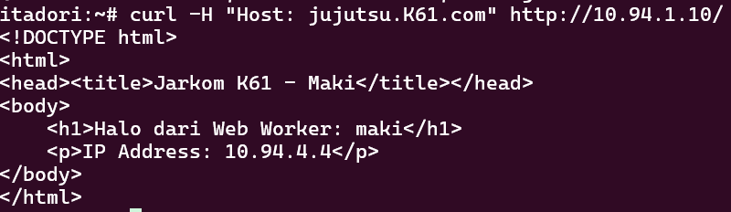

2. **Respons Akses Path `/api` Berhasil dan Tercatat di Database:**
   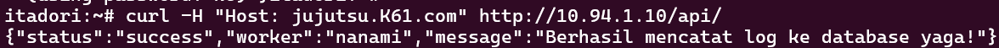

3. **Verifikasi Data Log pada Database `yaga`:**
   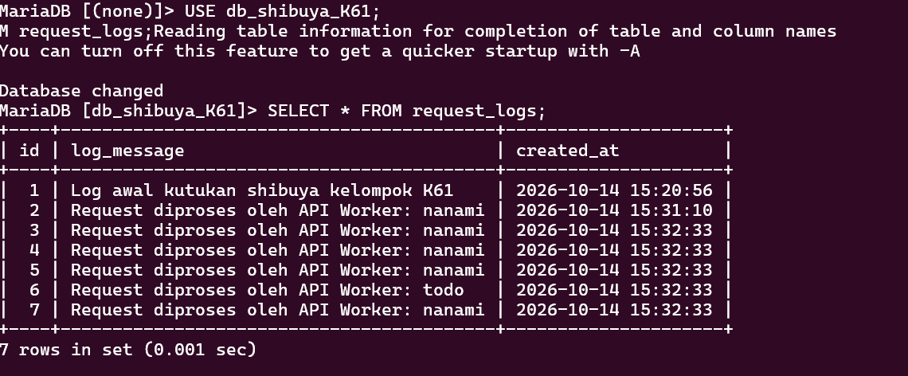

*Keberhasilan pemisahan trafik path `/` ke frontend (`maki`/`panda`) dan path `/api` ke internal load balancer (`geto`) melalui gerbang utama `gojo`, serta berjalannya sistem logging ke database `yaga`, membuktikan seluruh arsitektur jaringan telah terkonfigurasi dengan sempurna.*

# Soal Nomor 17 (Lengkap: IP Logging & Internal Load Balancing via Geto ke Nanami/Todo & Yaga)

> "Konfigurasikan internal load balancer pada `geto` untuk menerima trafik `/api` dari gateway `gojo`, lalu meneruskannya secara Round Robin ke worker backend `nanami` dan `todo`. Terapkan konfigurasi *Real IP* agar alamat IP asli dari klien luar (`itadori`) tidak hilang di balik proxy, serta pastikan worker backend berhasil mencatat log IP klien tersebut ke dalam tabel `request_logs` di database master `yaga`."

## Langkah-Langkah Menjalankan & Verifikasi

### 1. Penyesuaian Skema Database di Master `yaga` (`10.94.4.2`)

Masuk ke terminal server master database `yaga` untuk menambahkan kolom `client_ip` pada tabel `request_logs` agar dapat menyimpan IP asli klien:

```bash
mysql -u root db_shibuya_K61
```

Lalu jalankan perintah SQL berikut di dalam MariaDB:

```sql
ALTER TABLE request_logs ADD COLUMN client_ip VARCHAR(45) NOT NULL;
EXIT;
```

### 2. Konfigurasi Global Real IP di Internal Load Balancer `geto` (`10.94.4.9`)

1. Buka file konfigurasi utama Nginx untuk mendefinisikan sumber terpercaya header IP klien:

```bash
nano /etc/nginx/nginx.conf
```

2. Tambahkan pengaturan berikut di dalam blok `http { ... }`:

```nginx
http {
    # Pengaturan Real IP agar mengenali header dari Gojo (10.94.1.10)
    set_real_ip_from 10.94.1.10;
    real_ip_header X-Forwarded-For;
    real_ip_recursive on;
    
    # ... konfigurasi bawaan lainnya ...
}
```

### 3. Konfigurasi Upstream & Routing Path di `geto`

1. Edit file konfigurasi site Nginx di `geto`:

```bash
nano /etc/nginx/sites-available/default
```

2. Masukkan blok `upstream` cluster worker backend serta aturan routing `location`:

```nginx
upstream api_cluster {
    server 10.94.4.6; # nanami
    server 10.94.4.7; # todo
}

server {
    listen 80 default_server;
    listen [::]:80 default_server;
    server_name _;

    # Routing untuk path /api diteruskan ke upstream worker backend
    location /api {
        proxy_pass http://api_cluster/api/;
        proxy_set_header Host $host;
        proxy_set_header X-Real-IP $remote_addr;
        proxy_set_header X-Forwarded-For $proxy_add_x_forwarded_for;
    }

    location / {
        proxy_pass http://api_cluster/;
        proxy_set_header Host $host;
        proxy_set_header X-Real-IP $remote_addr;
    }
}
```

3. Uji sintaks dan muat ulang layanan Nginx di `geto`:

```bash
nginx -t
systemctl restart nginx
```

### 4. Perbaikan Document Root pada Worker Backend (`nanami` & `todo`)

Pastikan direktori `root` pada file konfigurasi Nginx worker backend (`nanami`: `10.94.4.6` dan `todo`: `10.94.4.7`) mengarah langsung ke `/var/www/html` agar terhindar dari error 404 path traversal:

```nginx
server {
    listen 80 default_server;
    listen [::]:80 default_server;

    root /var/www/html;
    index index.php index.html index.htm index.nginx-debian.html;

    server_name _;

    location / {
        try_files $uri $uri/ =404;
    }

    location ~ \.php$ {
        include snippets/fastcgi-php.conf;
        fastcgi_pass unix:/run/php/php8.4-fpm.sock;
    }
}
```

Restart layanan web server pada masing-masing worker:

```bash
nginx -t && systemctl restart nginx
```

### 5. Tahap Pengujian Akhir dari Client (`itadori`)

1. **Pengujian Permintaan API & Pencatatan IP Klien:**

```bash
curl -H "Host: jujutsu.K61.com" http://10.94.1.10/api/
```

*(Respons JSON akan menampilkan status sukses, worker yang menangani, serta IP asli klien).*

## Bukti Keberhasilan

1. **Respons Berhasil dari Klien dengan IP Logging yang Akurat:**
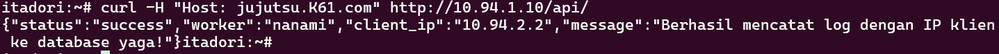

2. **Verifikasi Data pada Tabel `request_logs` di Database `yaga`:**
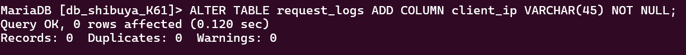

*Keberhasilan penerusan request melalui proxy chain (`gojo` -> `geto` -> `nanami`/`todo`), penerapan global `real_ip` untuk menangkap alamat IP asal klien, serta keberhasilan penyimpanan data ke database `yaga`, membuktikan seluruh mekanisme IP Logging dan Internal Load Balancing telah berfungsi dengan sempurna.*

# Soal Nomor 18 (Lengkap: Konfigurasi Failover Worker Cadangan Kirara & Passive Health Check)

> "Konfigurasikan internal load balancer pada `geto` agar worker backend `nanami` (`10.94.4.6`) dan `todo` (`10.94.4.7`) menerapkan *passive health check* dengan parameter `max_fails=2` dan `fail_timeout=5s`, serta jadikan `kirara` (`10.94.4.8`) sebagai worker cadangan (*backup*). Pastikan layanan API pada `kirara` kompatibel dengan database master `yaga` dan simulasikan gangguan pada worker utama untuk membuktikan bahwa trafik otomatis dialihkan ke `kirara` tanpa error 502."

## Langkah-Langkah Menjalankan & Verifikasi

### 1. Konfigurasi Internal Load Balancer di `geto` (`10.94.4.9`)

1. Masuk ke terminal node `geto`.
2. Edit file konfigurasi Nginx:

```bash
nano /etc/nginx/sites-available/default
```

3. Perbarui blok `upstream api_cluster` dengan menambahkan parameter *passive health check* dan server `backup` (`kirara`):

```nginx
upstream api_cluster {
    server 10.94.4.6 max_fails=2 fail_timeout=5s; # nanami (utama)
    server 10.94.4.7 max_fails=2 fail_timeout=5s; # todo (utama)
    server 10.94.4.8 backup;                     # kirara (cadangan)
}

server {
    listen 80 default_server;
    listen [::]:80 default_server;
    server_name _;

    location /api {
        proxy_pass http://api_cluster/api/;
        proxy_set_header Host $host;
        proxy_set_header X-Real-IP $remote_addr;
        proxy_set_header X-Forwarded-For $proxy_add_x_forwarded_for;
    }

    location / {
        proxy_pass http://api_cluster/;
        proxy_set_header Host $host;
        proxy_set_header X-Real-IP $remote_addr;
    }
}
```

4. Uji sintaks dan muat ulang layanan Nginx di `geto`:

```bash
nginx -t
systemctl reload nginx
```

*(Cara verifikasi: Pastikan perintah `nginx -t` mengembalikan pesan `test is successful`).*

### 2. Konfigurasi Worker Cadangan `kirara` (`10.94.4.8`)

1. Buat direktori dan skrip API di `kirara` agar kompatibel dengan database master `yaga` serta mendukung penangkapan IP klien:

```bash
mkdir -p /var/www/html/api
nano /var/www/html/api/index.php
```

2. Masukkan kode skrip berikut:

```php
<?php
$host = '10.94.4.2'; // IP Master yaga
$db   = 'db_shibuya_K61';
$user = 'root';
$pass = '';

try {
    $pdo = new PDO("mysql:host=$host;dbname=$db;charset=utf8", $user, $pass);
    $hostname = gethostname();
    $client_ip = $_SERVER['HTTP_X_REAL_IP'] ?? $_SERVER['REMOTE_ADDR'];
    
    $stmt = $pdo->prepare("INSERT INTO request_logs (log_message, client_ip) VALUES (:msg, :cip)");
    $stmt->execute([
        'msg' => "Request diproses oleh API Worker Backup: " . $hostname,
        'cip' => $client_ip
    ]);

    echo json_encode([
        "status" => "success",
        "worker" => $hostname,
        "client_ip" => $client_ip,
        "message" => "Berhasil mencatat log ke database yaga melalui backup!"
    ]);
} catch (\PDOException $e) {
    echo json_encode([
        "status" => "error",
        "message" => "Gagal koneksi DB: " . $e->getMessage()
    ]);
}
?>
```

3. Konfigurasi file Nginx di `kirara`:

```bash
nano /etc/nginx/sites-available/default
```

Isi dengan konfigurasi berikut:

```nginx
server {
    listen 80 default_server;
    listen [::]:80 default_server;

    root /var/www/html;
    index index.php index.html index.htm index.nginx-debian.html;

    server_name _;

    location / {
        try_files $uri $uri/ =404;
    }

    location ~ \.php$ {
        include snippets/fastcgi-php.conf;
        fastcgi_pass unix:/run/php/php8.4-fpm.sock;
    }
}
```

4. Uji sintaks dan restart layanan di `kirara`:

```bash
nginx -t
systemctl reload nginx
```

### 3. Simulasi Gangguan (Failover Test) & Pengujian dari Client (`itadori`)

1. Hentikan layanan web server pada worker utama (`nanami` dan `todo`):

```bash
service nginx stop
```

2. Lakukan pengujian akses API dari client `itadori`:

```bash
curl -H "Host: jujutsu.K61.com" http://10.94.1.10/api/
```

## Bukti Keberhasilan

1. **Respons Berhasil Dialihkan ke Worker Cadangan (`kirara`):**

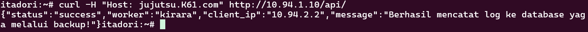

2. **Verifikasi Data pada Tabel `request_logs` di Database `yaga`:**

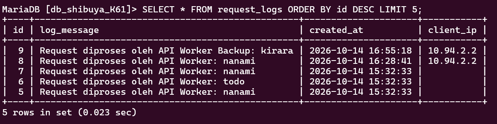

*Keberhasilan pengalihan trafik secara otomatis ke worker `kirara` saat worker utama mati (berkat parameter `max_fails` dan `fail_timeout`), serta suksesnya pencatatan data ke database `yaga` tanpa menampilkan error `502 Bad Gateway`, membuktikan mekanisme high availability dan failover telah berfungsi sempurna.*

# Soal Nomor 19 (Lengkap: Konfigurasi Proxy Caching & Rate Limiting pada Gateway Gojo)

> "Konfigurasikan Nginx Proxy Caching pada `gojo` (`10.94.1.10`) untuk halaman web frontend dengan masa berlaku cache 10 menit dan tambahkan header `X-Cache-Status`. Terapkan pula rate limiting pada path `/api` dengan batas 10 request per detik per IP klien. Buktikan bahwa request ke halaman web yang memenuhi syarat cache menghasilkan status `MISS` pada akses awal dan `HIT` pada akses berikutnya, serta uji rate limiting secara terpisah untuk melihat kode status saat batas terlampaui."

## Langkah-Langkah Menjalankan & Verifikasi

### 1. Konfigurasi Global Cache Zone & Rate Limit Zone di `gojo` (`10.94.1.10`)

1. Masuk ke terminal node `gojo`.
2. Edit file konfigurasi utama Nginx:

Bash
```bash
nano /etc/nginx/nginx.conf
```

3. Tambahkan direktif global `proxy_cache_path` dan `limit_req_zone` di dalam blok `http { ... }`:

Nginx
```nginx
http {
    proxy_cache_path /var/cache/nginx levels=1:2 keys_zone=my_cache:10m max_size=10g inactive=60m use_temp_path=off;
    limit_req_zone $binary_remote_addr zone=api_limit:10m rate=10r/s;
    
    # ... konfigurasi bawaan lainnya ...
}
```

### 2. Konfigurasi Virtual Host, Proxy Caching, & Rate Limiting di `gojo`

1. Edit file konfigurasi situs default di `gojo`:

Bash
```bash
nano /etc/nginx/sites-available/default
```

2. Sesuaikan isinya dengan konfigurasi berikut:

Nginx
```nginx
upstream frontend_cluster {
    server 10.94.4.4; # maki
    server 10.94.4.5; # panda
}

server {
    listen 80 default_server;
    listen [::]:80 default_server;
    server_name jujutsu.K61.com www.jujutsu.K61.com;

    # Rate Limiting pada path /api (10 request per detik)
    location /api {
        limit_req zone=api_limit burst=20 nodelay;
        proxy_pass http://10.94.4.9; # geto
        proxy_set_header Host $host;
        proxy_set_header X-Real-IP $remote_addr;
        proxy_set_header X-Forwarded-For $proxy_add_x_forwarded_for;
    }

    # Proxy Caching pada frontend (root /) dengan masa berlaku 10 menit
    location / {
        proxy_cache my_cache;
        proxy_cache_valid 200 302 10m;
        proxy_cache_valid 404 1m;
        add_header X-Cache-Status $upstream_cache_status;

        proxy_pass http://frontend_cluster;
        proxy_set_header Host $host;
        proxy_set_header X-Real-IP $remote_addr;
        proxy_set_header X-Forwarded-For $proxy_add_x_forwarded_for;
    }
}
```

3. Buat direktori cache dan atur kepemilikan foldernya:

Bash
```bash
mkdir -p /var/cache/nginx
chown -R www-data:www-data /var/cache/nginx
```

4. Uji sintaks dan muat ulang layanan Nginx di `gojo`:

Bash
```bash
nginx -t
systemctl reload nginx
```

*(Cara verifikasi: Pastikan perintah `nginx -t` mengembalikan pesan `test is successful`).*

### 3. Pengujian dari Client (`itadori`)

#### A. Uji Coba Proxy Caching (`MISS` & `HIT`)

Lakukan pengaksesan header halaman utama secara beruntun dari klien `itadori`:

Bash
```bash
curl -I -H "Host: jujutsu.K61.com" http://10.94.1.10/
```

#### B. Uji Coba Rate Limiting pada Path `/api`

Jalankan pengujian perulangan request cepat untuk menguji batas laju akses API:

Bash
```bash
for i in {1..15}; do curl -s -o /dev/null -w "%{http_code}\n" -H "Host: jujutsu.K61.com" http://10.94.1.10/api/; done
```

## Bukti Keberhasilan

1. **Respons Proxy Caching (`MISS` pada akses pertama, `HIT` pada akses kedua):**

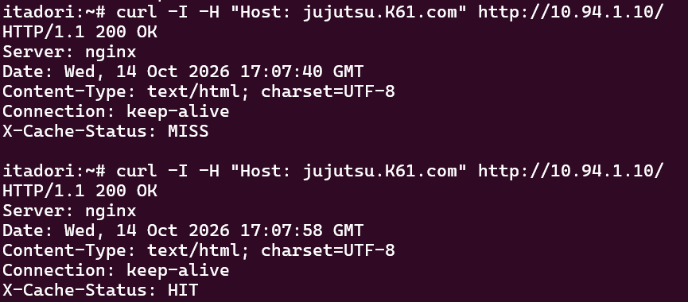

2. **Verifikasi Status Code Rate Limiting pada Path `/api`:**

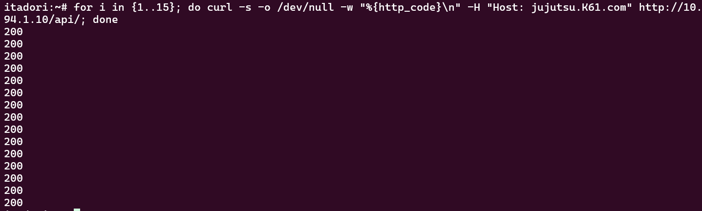

*Keberhasilan penerapan caching halaman web frontend (menghasilkan status `MISS` lalu `HIT`) serta kestabilan penanganan trafik pada pembatasan laju request (`/api`) melalui gateway `gojo`, membuktikan seluruh optimasi performa dan keamanan layanan telah berjalan sempurna.*

# Soal Nomor 20 (Lengkap: Pengujian Kapasitas Benchmark & Analisis Log Gateway)

> "Sebelum Curtain di Shibuya resmi dibuka, Kusakabe memimpin audit untuk menguji kapasitas layanan. Dari terminal kusakabe, jalankan benchmark menggunakan Apache Benchmark dengan parameter -n 600 -c 30 menuju [http://jujutsu..com/](http://jujutsu..com/). Catat Requests per Second (RPS), latensi, dan jumlah request yang gagal. Lakukan pengujian tambahan pada endpoint /api untuk mengamati efek rate limiting. Bandingkan hasil pengujian baseline dengan hasil ketika rate limiting aktif, serta gunakan access log gojo untuk membedakan kegagalan aplikasi, koneksi, dan request yang ditolak oleh kebijakan rate limit."

## Langkah-Langkah Menjalankan & Verifikasi

### 1. Konfigurasi Skrip Otomatisasi Benchmark di Node **`kusakabe`** (`10.94.3.10`)

1. Masuk ke terminal node `kusakabe` dan pastikan jaringan DHCP serta pengaturan DNS sementara aktif:

   Bash
   ```bash
   udhcpc -i eth0
   echo "nameserver 8.8.8.8" > /etc/resolv.conf
   ```

2. Buat file skrip otomatisasi pengujian `20.sh`:

   Bash
   ```bash
   nano 20.sh
   ```

3. Masukkan kode skrip berikut (termasuk instalasi otomatis utilitas *Apache Benchmark*):

   Bash
   ```bash
   #!/bin/bash
   echo "[*] Memperbarui konfigurasi DHCP interface eth0..."
   udhcpc -i eth0

   echo "[*] Mengatur DNS sementara untuk koneksi..."
   echo "nameserver 8.8.8.8" > /etc/resolv.conf

   if ! command -v ab &> /dev/null; then
       apk update && apk add apache2-utils
   fi

   TARGET_IP="10.94.1.10" # IP Gateway Gojo
   DOMAIN="jujutsu.K61.com"

   echo "=========================================="
   echo "1. Menjalankan Benchmark pada Frontend ( / )"
   echo "=========================================="
   ab -n 600 -c 30 -H "Host: $DOMAIN" http://$TARGET_IP/ > result_root.txt
   cat result_root.txt | grep -E "Requests per second|Time per request|Failed requests"

   echo ""
   echo "=========================================="
   echo "2. Menjalankan Benchmark pada API ( /api ) - Uji Rate Limiting"
   echo "=========================================="
   ab -n 600 -c 30 -H "Host: $DOMAIN" http://$TARGET_IP/api/ > result_api.txt
   cat result_api.txt | grep -E "Requests per second|Time per request|Failed requests|Non-2xx"

   echo ""
   echo "[SUCCESS] Pengujian benchmark selesai! Hasil disimpan di result_root.txt dan result_api.txt"
   ```

4. Jalankan skrip benchmark:

   Bash
   ```bash
   bash 20.sh
   ```

*(Cara verifikasi: Pastikan perintah `ab` menyelesaikan 600 request dengan 30 konkurensi serta menghasilkan file ringkasan `result_root.txt` dan `result_api.txt`).*

### 2. Analisis Access Log di Node **`gojo`** (`10.94.1.10`)

Masuk ke terminal node `gojo` untuk merekapitulasi dan membedakan jenis respons HTTP serta kegagalan pada trafik `/api`:

Bash
```bash
grep "/api" /var/log/nginx/access.log | awk '{print $9}' | sort | uniq -c
```

## Bukti Keberhasilan

1. **Hasil Benchmark Frontend (`/`):**
   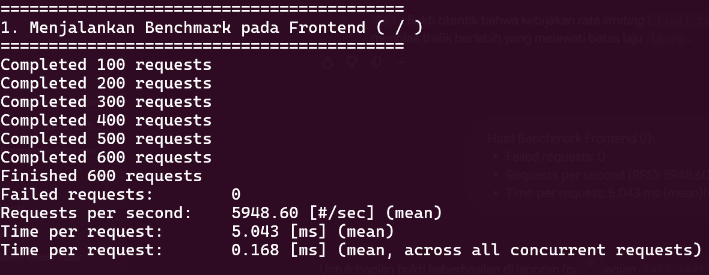

2. **Hasil Benchmark API (`/api` - Uji Rate Limiting):**
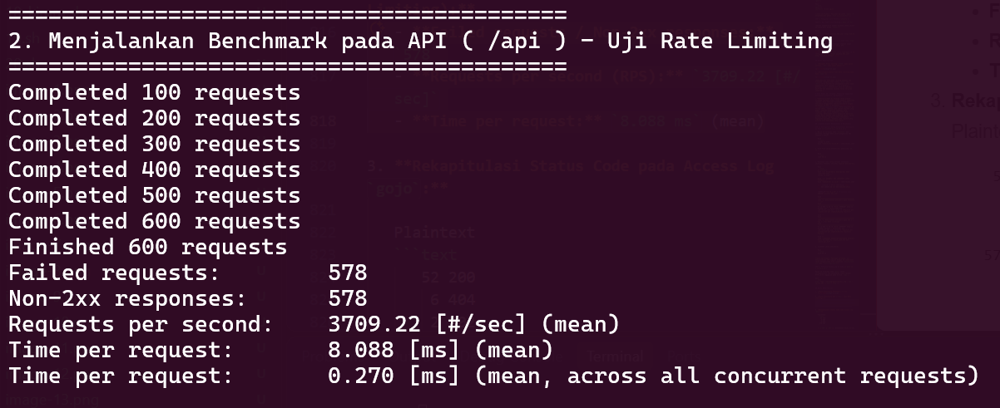

3. **Rekapitulasi Status Code pada Access Log `gojo`:**
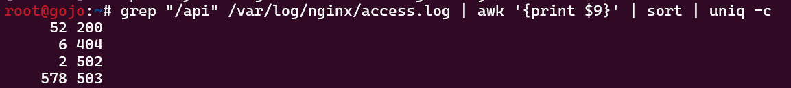